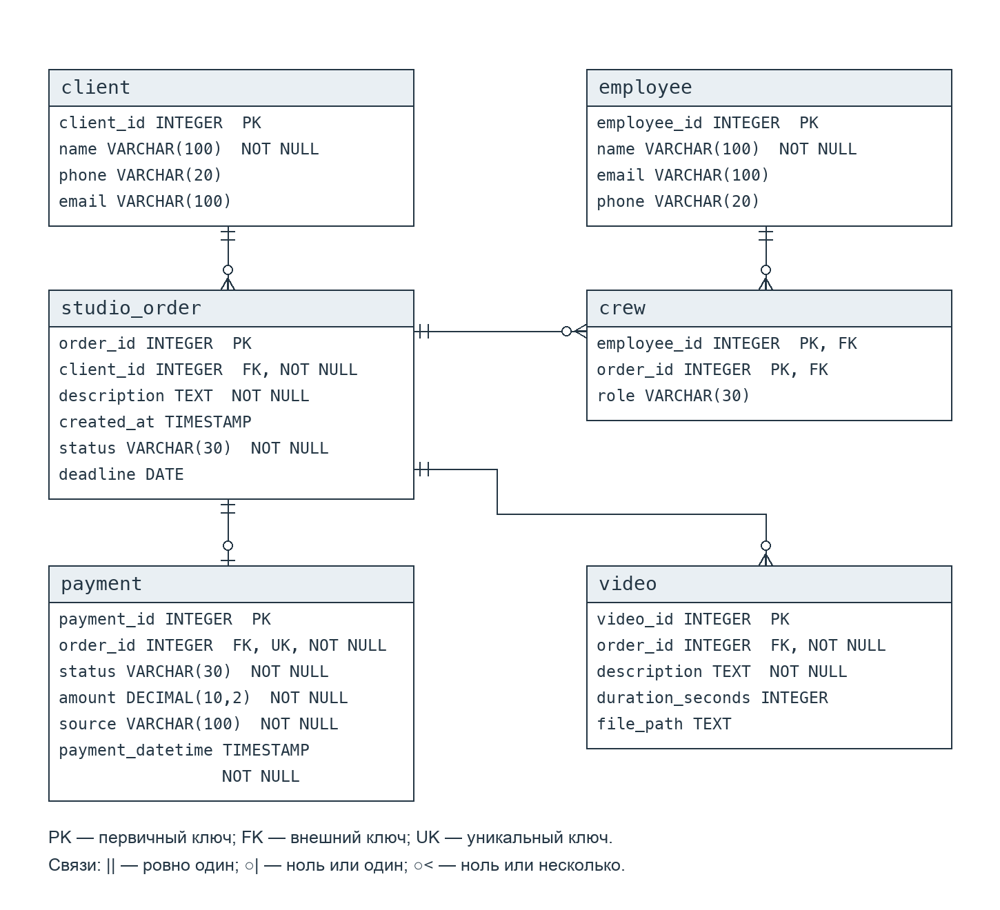

# HW3 — Нормальные формы

## Проверка схемы

Используем схему после всех изменений из HW2, включая контактные данные, статус и срок заказа, длительность и путь к видеофайлу.

Основные функциональные зависимости:

- `client`: `client_id → name, phone, email`.
- `employee`: `employee_id → name, email, phone`.
- `studio_order`: `order_id → client_id, description, created_at, status, deadline`.
- `crew`: `(employee_id, order_id) → role`.
- `video`: `video_id → order_id, description, duration_seconds, file_path`.
- `payment`: `payment_id → order_id, status, amount, source, payment_datetime`. Также `order_id → payment_id, status, amount, source, payment_datetime`, потому что `order_id` имеет ограничения `UNIQUE` и `NOT NULL`.

Все значения атомарные — выполняется 1НФ. В `crew` роль зависит от всего составного ключа: сотрудник может выполнять разные роли на разных заказах. В остальных таблицах ключи состоят из одного поля, поэтому частичных зависимостей нет — выполняется 2НФ.

Неключевые поля не определяют другие неключевые поля, транзитивных зависимостей от ключей нет — выполняется 3НФ. Во всех нетривиальных функциональных зависимостях определяющая часть является суперключом — выполняется НФБК. У `payment` два кандидатных ключа: `payment_id` и `order_id`. Имена, email и роли уникальными не считаются.

Нарушений в текущей схеме нет, менять таблицы не нужно. Ниже два учебных примера на её основе.

## 1. Имя сотрудника в crew

Предположим, добавили имя сотрудника в таблицу назначений:

```text
crew(employee_id, order_id, role, employee_name)
PRIMARY KEY (employee_id, order_id)
```

Зависимость `employee_id → employee_name` означает, что имя зависит только от части составного ключа. Это нарушает 2НФ, а также 3НФ и НФБК: `employee_id` не является суперключом `crew`, а имя — неключевое поле.

Возникают аномалии:

- Обновление: имя сотрудника нужно менять во всех его назначениях.
- Вставка: в этой таблице нельзя сохранить сотрудника без заказа.
- Удаление: при удалении последнего назначения из неё исчезнет и имя сотрудника.

Убираем `employee_name` из `crew`. Имя храним в `employee(employee_id, name, email, phone)`, а в `crew` оставляем `employee_id`, `order_id` и `role`. Составной ключ сохраняем.

## 2. Имя клиента в studio_order

Предположим, добавили имя клиента в заказ:

```text
studio_order(order_id, client_id, description, created_at, status, deadline, client_name)
PRIMARY KEY (order_id)
```

Получается транзитивная зависимость `order_id → client_id → client_name`. Таблица остаётся во 2НФ, но нарушает 3НФ и НФБК: `client_id` не является суперключом заказа, а `client_name` — неключевое поле.

Возникают аномалии:

- Обновление: имя клиента нужно менять во всех его заказах.
- Вставка: в этой таблице нельзя сохранить клиента без заказа.
- Удаление: при удалении последнего заказа из неё исчезнет и имя клиента.

Убираем `client_name` из `studio_order`. Имя храним в `client(client_id, name, phone, email)`, а заказ связываем с клиентом через `client_id`.

## ER-диаграмма

Итоговая схема совпадает со схемой после HW2.


