# HW4 — SELECT и JOIN

## Выборка всех данных из таблицы

### 1. Все данные клиентов

```sql
SELECT *
FROM client;
```

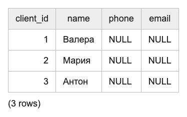

### 2. Все данные сотрудников

```sql
SELECT *
FROM employee;
```

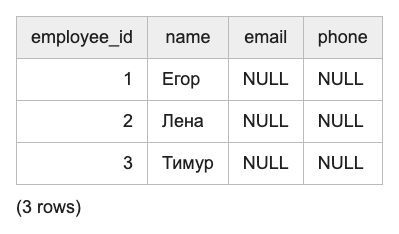

## Выборка отдельных столбцов

### 3. Имена и email сотрудников

```sql
SELECT name, email
FROM employee;
```

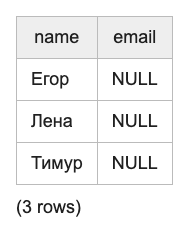

### 4. Номера видео и их описания

```sql
SELECT video_id, description
FROM video;
```

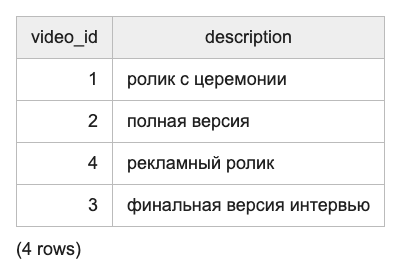

## Присвоение новых имен столбцам при формировании выборки

### 5. Клиенты с понятными названиями столбцов

```sql
SELECT client_id AS "Код клиента", name AS "Клиент"
FROM client;
```

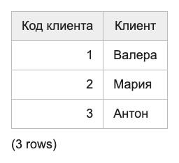

### 6. Оплаты с понятными названиями столбцов

```sql
SELECT payment_id AS "Оплата", amount AS "Сумма"
FROM payment;
```

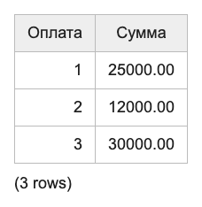

## Выборка данных с созданием вычисляемого столбца

### 7. Расчёт аванса в размере 30% от суммы оплаты

```sql
SELECT payment_id, amount, amount * 0.3 AS advance_amount
FROM payment;
```

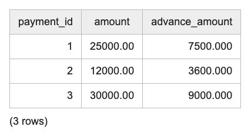

### 8. Дата через неделю после создания заказа

```sql
SELECT order_id, created_at, created_at + INTERVAL '7 days' AS date_in_week
FROM studio_order;
```

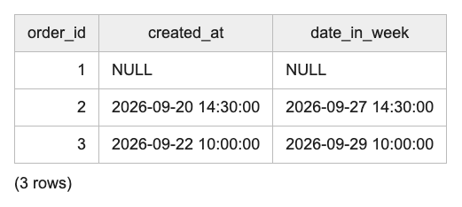

## Выборка данных, вычисляемые столбцы, математические функции

### 9. Сумма одной из трёх равных частей оплаты с округлением

```sql
SELECT payment_id, ROUND(amount / 3, 2) AS installment_amount
FROM payment;
```

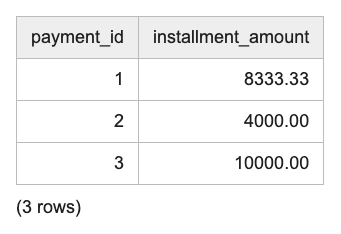

### 10. Разница между суммой оплаты и бюджетом в 20000 рублей

```sql
SELECT payment_id, amount, ABS(amount - 20000) AS budget_difference
FROM payment;
```


## Выборка данных, вычисляемые столбцы, логические функции (CASE)

### 11. Категория оплаты по сумме

```sql
SELECT payment_id, amount,
       CASE
           WHEN amount < 15000 THEN 'Небольшая'
           WHEN amount < 30000 THEN 'Средняя'
           ELSE 'Крупная'
       END AS amount_category
FROM payment;
```

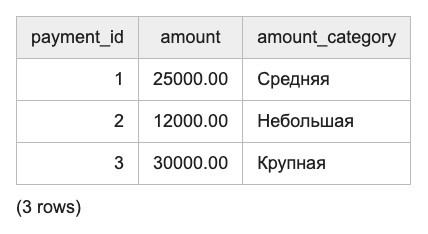

### 12. Указана ли дата создания заказа

```sql
SELECT order_id, description,
       CASE
           WHEN created_at IS NULL THEN 'Дата не указана'
           ELSE 'Дата указана'
       END AS date_status
FROM studio_order;
```

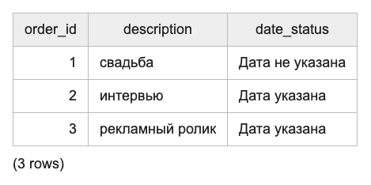

## Выборка данных по условию

### 13. Оплаты больше 20000 рублей

```sql
SELECT payment_id, order_id, amount
FROM payment
WHERE amount > 20000;
```

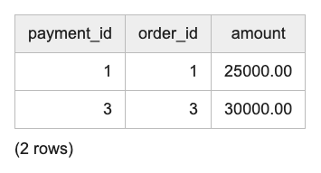

### 14. Назначения операторов

```sql
SELECT employee_id, order_id, role
FROM crew
WHERE role = 'оператор';
```

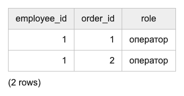

## Выборка данных, логические операции

### 15. Успешные оплаты от 20000 рублей

```sql
SELECT payment_id, amount, status
FROM payment
WHERE status = 'success' AND amount >= 20000;
```

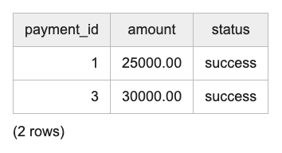

### 16. Оплаты картой или наличными

```sql
SELECT payment_id, amount, source
FROM payment
WHERE source = 'card' OR source = 'cash';
```

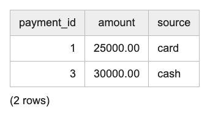

## Выборка данных, операторы BETWEEN, IN

### 17. Оплаты от 10000 до 25000 рублей

```sql
SELECT payment_id, amount
FROM payment
WHERE amount BETWEEN 10000 AND 25000;
```

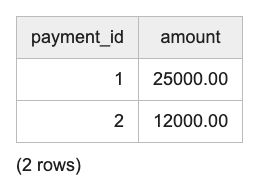

### 18. Заказы на свадьбу или интервью

```sql
SELECT order_id, description
FROM studio_order
WHERE description IN ('свадьба', 'интервью');
```

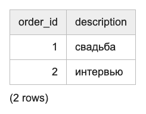

## Выборка данных с сортировкой

### 19. Клиенты по имени

```sql
SELECT client_id, name
FROM client
ORDER BY name;
```

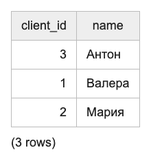

### 20. Успешные оплаты от большей суммы к меньшей

```sql
SELECT payment_id, order_id, amount, source
FROM payment
WHERE status = 'success'
ORDER BY amount DESC;
```

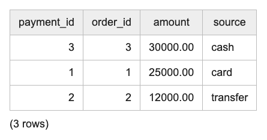

## Выборка данных, оператор LIKE

### 21. Клиенты с именем на букву М

```sql
SELECT client_id, name
FROM client
WHERE name LIKE 'М%';
```

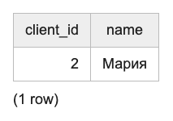

### 22. Видео со словом «интервью» в описании

```sql
SELECT video_id, description
FROM video
WHERE description LIKE '%интервью%';
```

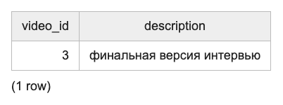

## Выбор уникальных элементов столбца

### 23. Роли сотрудников на заказах

```sql
SELECT DISTINCT role
FROM crew;
```

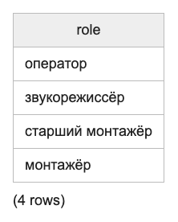

### 24. Способы оплаты

```sql
SELECT DISTINCT source
FROM payment;
```

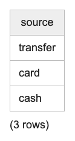

## Выбор ограниченного количества возвращаемых строк

### 25. Две самые крупные оплаты

```sql
SELECT payment_id, amount
FROM payment
ORDER BY amount DESC
LIMIT 2;
```

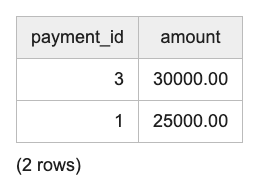

### 26. Вторая страница списка видео по два видео на странице

```sql
SELECT video_id, description
FROM video
ORDER BY video_id
LIMIT 2 OFFSET 2;
```

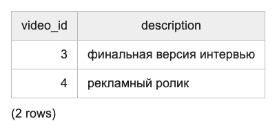

## INNER JOIN

### 27. Заказы и имена клиентов

```sql
SELECT o.order_id, o.description, c.name
FROM studio_order AS o
INNER JOIN client AS c ON o.client_id = c.client_id;
```

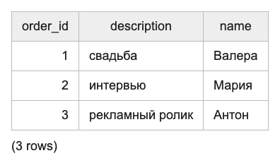

### 28. Сотрудники и их роли на заказах

```sql
SELECT e.name, c.order_id, c.role
FROM employee AS e
INNER JOIN crew AS c ON e.employee_id = c.employee_id;
```

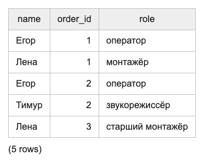

## LEFT JOIN

### 29. Все клиенты и их заказы, включая клиентов без заказов

```sql
SELECT c.client_id, c.name, o.order_id, o.description
FROM client AS c
LEFT JOIN studio_order AS o ON c.client_id = o.client_id;
```

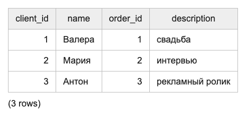

### 30. Все заказы и их видео, включая заказы без видео

```sql
SELECT o.order_id, o.description AS order_description,
       v.video_id, v.description AS video_description
FROM studio_order AS o
LEFT JOIN video AS v ON o.order_id = v.order_id;
```

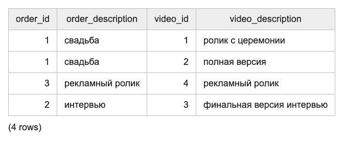

## RIGHT JOIN

### 31. Все сотрудники и их назначения, включая сотрудников без заказов

```sql
SELECT e.employee_id, e.name, c.order_id, c.role
FROM crew AS c
RIGHT JOIN employee AS e ON c.employee_id = e.employee_id;
```

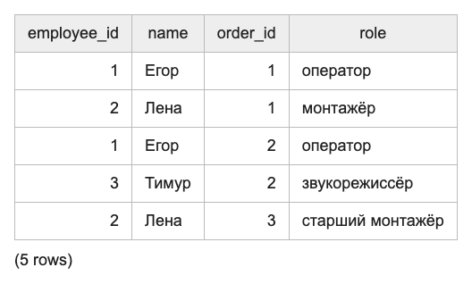

### 32. Все заказы и суммы оплат, включая заказы без оплаты

```sql
SELECT o.order_id, o.description, p.amount
FROM payment AS p
RIGHT JOIN studio_order AS o ON p.order_id = o.order_id;
```

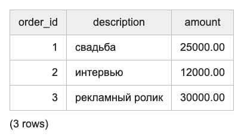

## CROSS JOIN

### 33. Возможные назначения сотрудников на заказы

```sql
SELECT e.employee_id, e.name, o.order_id, o.description
FROM employee AS e
CROSS JOIN studio_order AS o;
```

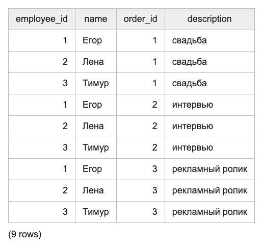

### 34. Возможные пары клиентов и сотрудников для консультации

```sql
SELECT c.name AS client_name, e.name AS employee_name
FROM client AS c
CROSS JOIN employee AS e;
```

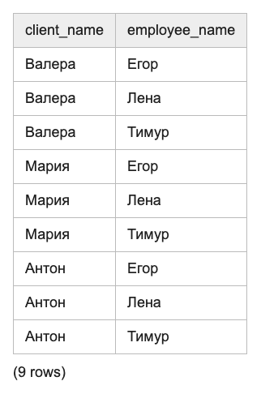

## FULL OUTER JOIN

### 35. Все заказы и оплаты, включая заказы без оплаты

```sql
SELECT o.order_id, o.description, p.payment_id, p.amount, p.status
FROM studio_order AS o
FULL OUTER JOIN payment AS p ON o.order_id = p.order_id;
```

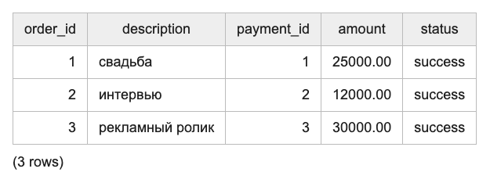

### 36. Видео и оплаты одного заказа, включая видео без оплаты и оплаты заказов без видео

```sql
SELECT v.video_id, v.order_id AS video_order_id, v.description,
       p.payment_id, p.order_id AS payment_order_id, p.amount
FROM video AS v
FULL OUTER JOIN payment AS p ON v.order_id = p.order_id;
```

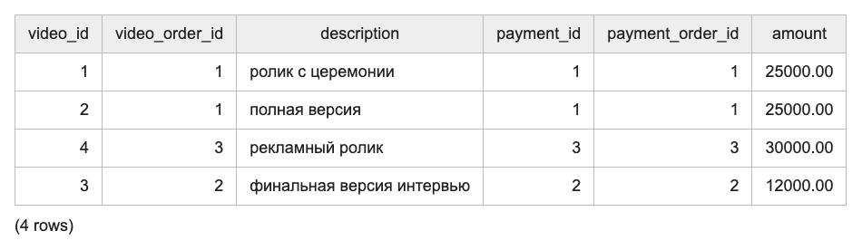

## Запросы на выборку из нескольких таблиц

### 37. Сотрудники, их роли и описания заказов

```sql
SELECT e.name, c.role, o.order_id, o.description
FROM employee AS e
INNER JOIN crew AS c ON e.employee_id = c.employee_id
INNER JOIN studio_order AS o ON c.order_id = o.order_id;
```

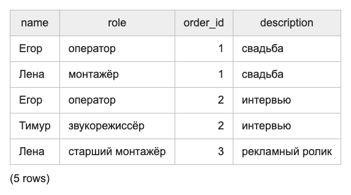

### 38. Клиенты и суммы оплат за их заказы

```sql
SELECT c.name, o.order_id, o.description, p.amount
FROM client AS c
INNER JOIN studio_order AS o ON c.client_id = o.client_id
INNER JOIN payment AS p ON o.order_id = p.order_id;
```

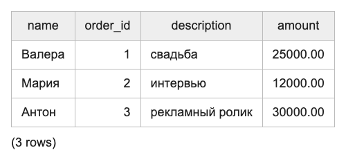
