# HW5 — Агрегатные функции и группировка

## COUNT()

### 1. Количество заказов

```sql
SELECT COUNT(*) AS order_count
FROM studio_order;
```

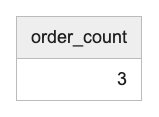

### 2. Количество сотрудников, назначенных на заказы

```sql
SELECT COUNT(DISTINCT employee_id) AS employee_count
FROM crew;
```

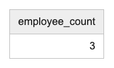

## SUM()

### 3. Общая сумма успешных оплат

```sql
SELECT SUM(amount) AS total_amount
FROM payment
WHERE status = 'success';
```

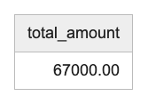

### 4. Общая сумма авансов по 30% от каждой оплаты

```sql
SELECT SUM(amount * 0.3) AS total_advance
FROM payment;
```

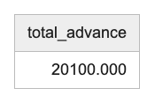

## AVG()

### 5. Средняя сумма оплаты

```sql
SELECT ROUND(AVG(amount), 2) AS average_amount
FROM payment;
```

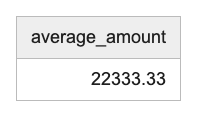

### 6. Средняя сумма безналичной оплаты

```sql
SELECT ROUND(AVG(amount), 2) AS average_amount
FROM payment
WHERE source IN ('card', 'transfer');
```

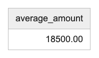

## MIN()

### 7. Минимальная сумма оплаты

```sql
SELECT MIN(amount) AS min_amount
FROM payment;
```

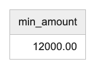

### 8. Самая ранняя дата создания заказа

```sql
SELECT MIN(created_at) AS first_order_date
FROM studio_order;
```

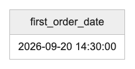

## MAX()

### 9. Максимальная сумма оплаты

```sql
SELECT MAX(amount) AS max_amount
FROM payment;
```


### 10. Дата последней оплаты

```sql
SELECT MAX(payment_datetime) AS last_payment_date
FROM payment;
```

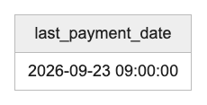

## STRING_AGG()

### 11. Имена клиентов одной строкой

```sql
SELECT STRING_AGG(name, ', ' ORDER BY name) AS client_names
FROM client;
```

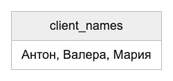

### 12. Список разных ролей съёмочной команды

```sql
SELECT STRING_AGG(DISTINCT role, ', ' ORDER BY role) AS roles
FROM crew;
```

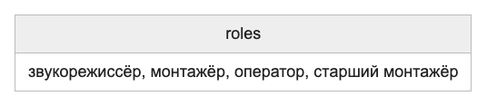

## GROUP BY

### 13. Количество видео по каждому заказу

```sql
SELECT order_id, COUNT(*) AS video_count
FROM video
GROUP BY order_id;
```

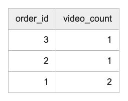

### 14. Сумма оплат по каждому способу оплаты

```sql
SELECT source, SUM(amount) AS total_amount
FROM payment
GROUP BY source;
```

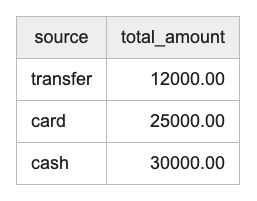

## HAVING

### 15. Сотрудники, назначенные больше чем на один заказ

```sql
SELECT employee_id, COUNT(*) AS order_count
FROM crew
GROUP BY employee_id
HAVING COUNT(*) > 1;
```

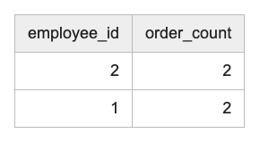

### 16. Заказы, для которых подготовлено больше одного видео

```sql
SELECT order_id, COUNT(*) AS video_count
FROM video
GROUP BY order_id
HAVING COUNT(*) > 1;
```

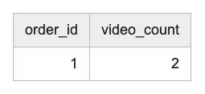

## GROUPING SETS

### 17. Суммы оплат по способам, по статусам и общий итог

```sql
SELECT source, status, SUM(amount) AS total_amount
FROM payment
GROUP BY GROUPING SETS ((source), (status), ());
```

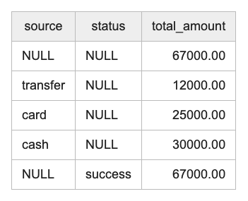

### 18. Количество назначений по сотрудникам, по заказам и общий итог

```sql
SELECT employee_id, order_id, COUNT(*) AS assignment_count
FROM crew
GROUP BY GROUPING SETS ((employee_id), (order_id), ());
```

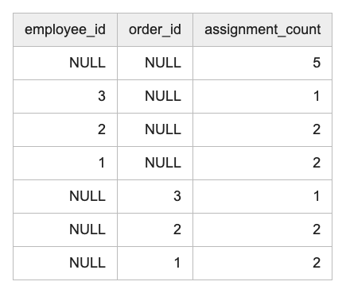

## ROLLUP

### 19. Суммы оплат по способу и статусу с итогами по способу и общим итогом

```sql
SELECT source, status, SUM(amount) AS total_amount
FROM payment
GROUP BY ROLLUP (source, status);
```

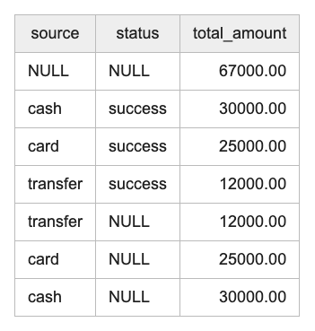

### 20. Количество назначений по заказу и роли с итогами по заказу и общим итогом

```sql
SELECT order_id, role, COUNT(*) AS assignment_count
FROM crew
GROUP BY ROLLUP (order_id, role);
```

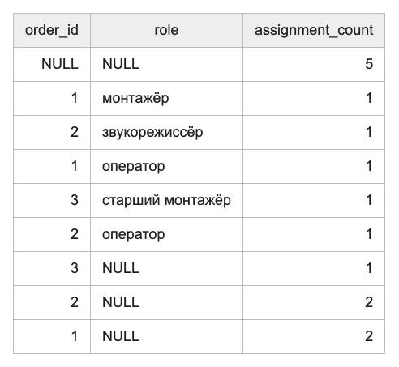

## CUBE

### 21. Суммы оплат по всем сочетаниям способа и статуса

```sql
SELECT source, status, SUM(amount) AS total_amount
FROM payment
GROUP BY CUBE (source, status);
```

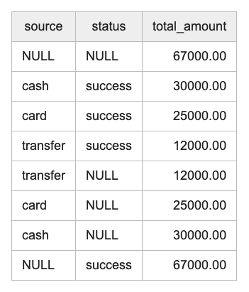

### 22. Количество назначений по всем сочетаниям сотрудника и заказа

```sql
SELECT employee_id, order_id, COUNT(*) AS assignment_count
FROM crew
GROUP BY CUBE (employee_id, order_id);
```

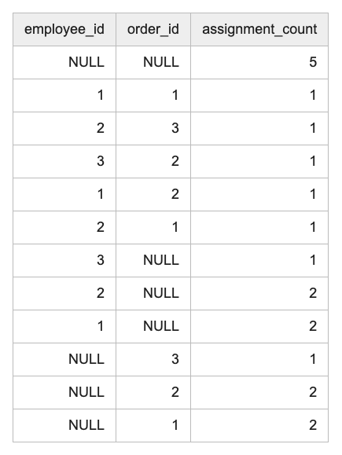

## SELECT, FROM, WHERE, GROUP BY, HAVING, ORDER BY

### 23. Способы безналичной оплаты с общей суммой от 15000 рублей

```sql
SELECT source, COUNT(*) AS payment_count, SUM(amount) AS total_amount
FROM payment
WHERE source IN ('card', 'transfer')
GROUP BY source
HAVING SUM(amount) >= 15000
ORDER BY total_amount DESC;
```

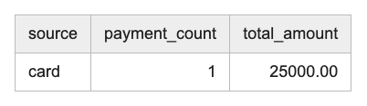

### 24. Сотрудники с несколькими назначениями оператором или монтажёром

```sql
SELECT employee_id, COUNT(*) AS order_count,
       STRING_AGG(order_id::TEXT, ', ' ORDER BY order_id) AS orders
FROM crew
WHERE role IN ('оператор', 'монтажёр')
GROUP BY employee_id
HAVING COUNT(*) > 1
ORDER BY order_count DESC, employee_id;
```

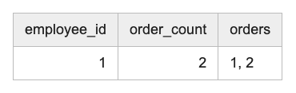
