# HW6 — Подзапросы

## 1. SELECT

### 1.1 Почта произвольного сотрудника с именем Егор

```sql
SELECT (
    SELECT email
    FROM employee
    WHERE name = 'Егор'
    LIMIT 1
) AS employee_email;
```

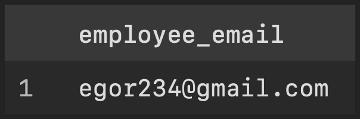

### 1.2 Оплаты и средняя сумма по всем оплатам

```sql
SELECT payment_id, amount,
       (SELECT ROUND(AVG(amount), 2) FROM payment) AS average_amount
FROM payment;
```

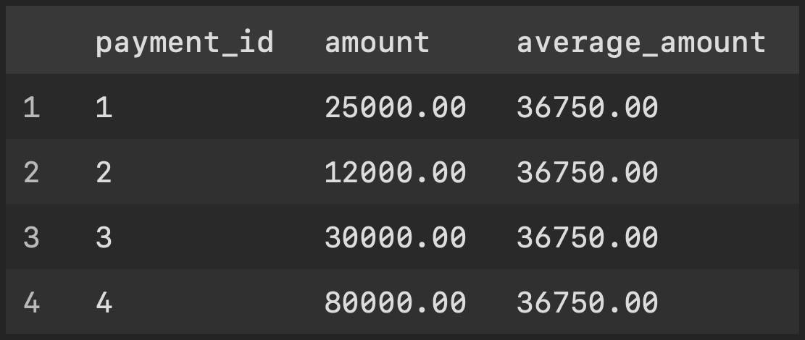

## 2. FROM

### 2.1 Источники оплаты со средним чеком больше 15000 рублей

```sql
SELECT source, average_payment
FROM (
    SELECT source, AVG(amount) AS average_payment
    FROM payment
    GROUP BY source
) AS payment_averages
WHERE average_payment > 15000;
```

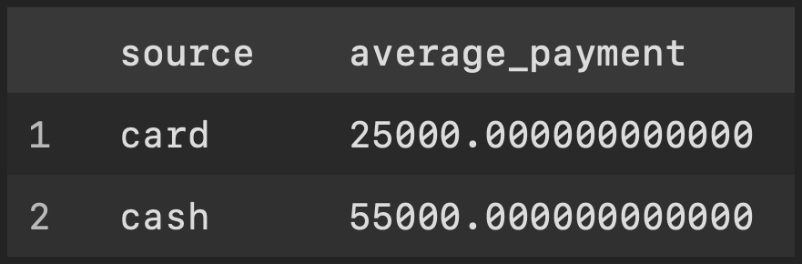

### 2.2 Заказы, для которых подготовлено больше одного видео

```sql
SELECT order_id, video_count
FROM (
    SELECT order_id, COUNT(*) AS video_count
    FROM video
    GROUP BY order_id
) AS video_counts
WHERE video_count > 1;
```

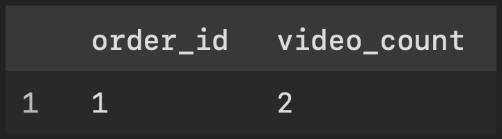

## 3. WHERE

### 3.1 Статус оплаты произвольного заказа на свадьбу

```sql
SELECT status
FROM payment
WHERE order_id = (
    SELECT order_id
    FROM studio_order
    WHERE description = 'свадьба'
    LIMIT 1
);
```

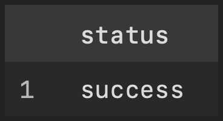

### 3.2 Оплаты выше среднего по всей таблице

```sql
SELECT payment_id, amount
FROM payment
WHERE amount > (SELECT AVG(amount) FROM payment);
```


## 4. HAVING

### 4.1 Источники оплаты со средним чеком выше общего среднего

```sql
SELECT source
FROM payment
GROUP BY source
HAVING AVG(amount) > (SELECT AVG(amount) FROM payment);
```

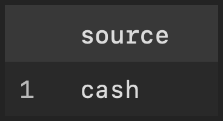

### 4.2 Источники, сумма оплат которых больше максимальной отдельной оплаты

```sql
SELECT source, SUM(amount) AS total_amount
FROM payment
GROUP BY source
HAVING SUM(amount) > (SELECT MAX(amount) FROM payment);
```

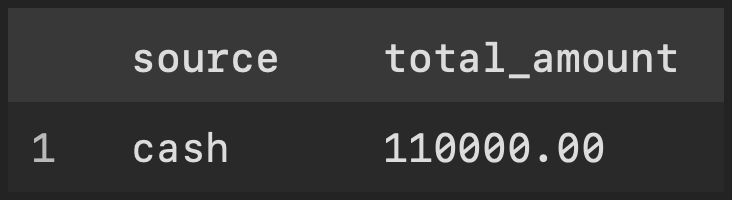

## 5. ALL

### 5.1 Суммы оплат, которые больше каждой оплаты переводом

```sql
SELECT amount
FROM payment
WHERE amount > ALL (
    SELECT amount
    FROM payment
    WHERE source = 'transfer'
);
```

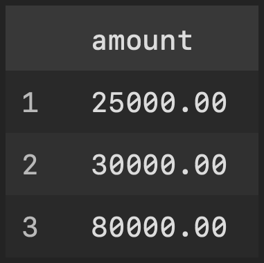

### 5.2 Оплаты с минимальной суммой

```sql
SELECT payment_id, amount
FROM payment
WHERE amount <= ALL (SELECT amount FROM payment);
```

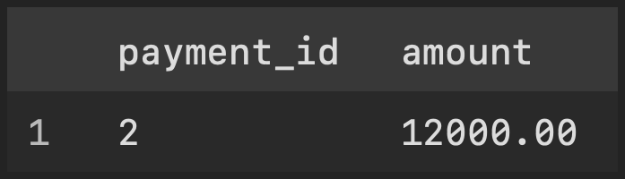

## 6. IN

### 6.1 Имена сотрудников с назначением оператором

```sql
SELECT name
FROM employee
WHERE employee_id IN (
    SELECT employee_id
    FROM crew
    WHERE role = 'оператор'
);
```

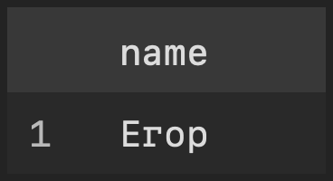

### 6.2 Клиенты, заказавшие съёмку свадьбы

```sql
SELECT client_id, name
FROM client
WHERE client_id IN (
    SELECT client_id
    FROM studio_order
    WHERE description = 'свадьба'
);
```

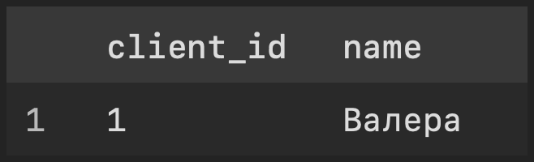

## 7. ANY

### 7.1 Оплаты больше хотя бы одной оплаты наличными

```sql
SELECT payment_id, amount
FROM payment
WHERE amount > ANY (
    SELECT amount
    FROM payment
    WHERE source = 'cash'
);
```

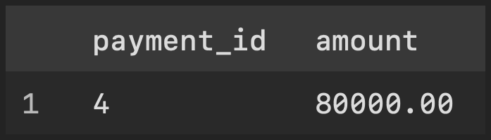

### 7.2 Сотрудники с монтажными назначениями

```sql
SELECT employee_id, name
FROM employee
WHERE employee_id = ANY (
    SELECT employee_id
    FROM crew
    WHERE role LIKE '%монтаж%'
);
```

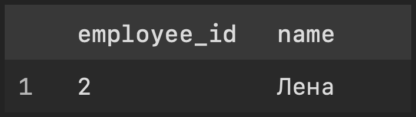

## 8. EXISTS и NOT EXISTS

### 8.1 Клиенты, у которых есть заказы

```sql
SELECT c.client_id, c.name
FROM client AS c
WHERE EXISTS (
    SELECT 1
    FROM studio_order AS o
    WHERE o.client_id = c.client_id
);
```

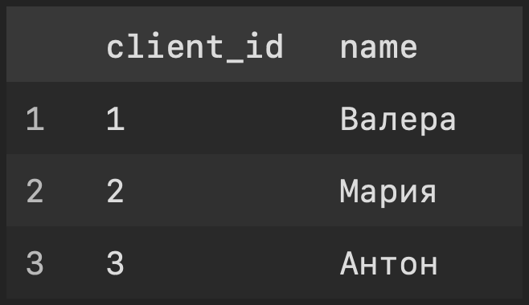

### 8.2 Заказы, на которые не назначен оператор

```sql
SELECT o.order_id, o.description
FROM studio_order AS o
WHERE NOT EXISTS (
    SELECT 1
    FROM crew AS c
    WHERE c.order_id = o.order_id AND c.role = 'оператор'
);
```

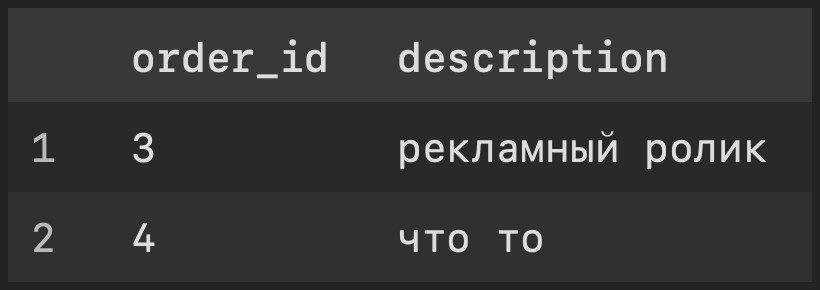

## 9. Сравнение по нескольким столбцам

### 9.1 Сотрудники и заказы с назначением оператором

```sql
SELECT e.name, o.order_id, o.description
FROM employee AS e
CROSS JOIN studio_order AS o
WHERE (e.employee_id, o.order_id) IN (
    SELECT employee_id, order_id
    FROM crew
    WHERE role = 'оператор'
);
```

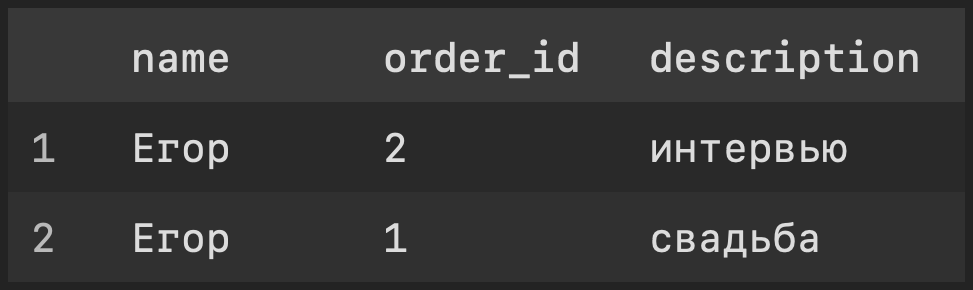

### 9.2 Оплата, соответствующая паре заказа и суммы самой крупной оплаты

```sql
SELECT payment_id, order_id, amount
FROM payment
WHERE (order_id, amount) = (
    SELECT order_id, amount
    FROM payment
    ORDER BY amount DESC, payment_id
    LIMIT 1
);
```

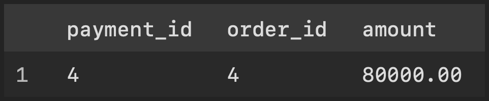

## 10. Коррелированные подзапросы

### 10.1 Сотрудники, у которых есть назначение оператором

```sql
SELECT e.name
FROM employee AS e
WHERE EXISTS (
    SELECT 1
    FROM crew AS c
    WHERE c.employee_id = e.employee_id AND c.role = 'оператор'
);
```


### 10.2 Количество видео для каждого заказа, включая заказы без видео

```sql
SELECT o.order_id, o.description,
       (SELECT COUNT(*) FROM video AS v WHERE v.order_id = o.order_id) AS video_count
FROM studio_order AS o;
```

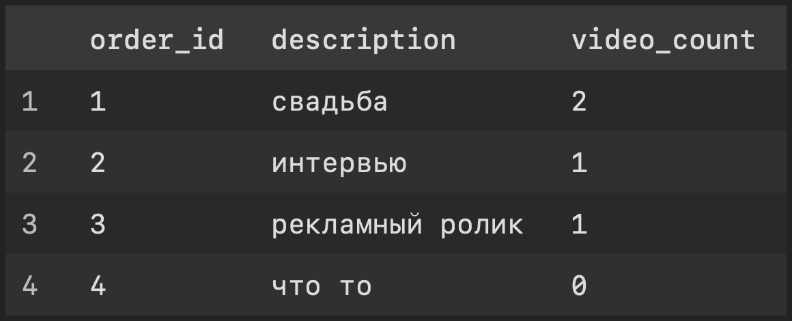

### 10.3 Оплаты выше среднего по своему источнику оплаты

```sql
SELECT p.payment_id, p.source, p.amount
FROM payment AS p
WHERE p.amount > (
    SELECT AVG(p2.amount)
    FROM payment AS p2
    WHERE p2.source = p.source
);
```

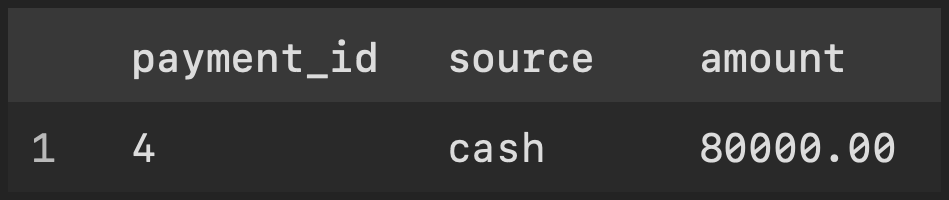

### 10.4 Максимальная сумма оплаты по заказам каждого клиента

```sql
SELECT c.client_id, c.name,
       (
           SELECT MAX(p.amount)
           FROM studio_order AS o
           INNER JOIN payment AS p ON p.order_id = o.order_id
           WHERE o.client_id = c.client_id
       ) AS max_payment
FROM client AS c;
```

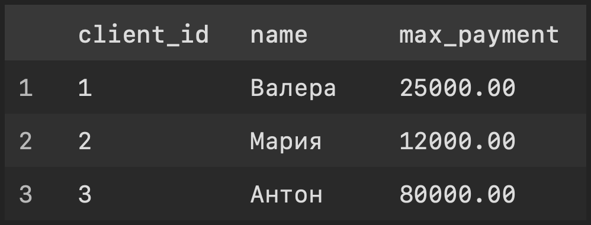

### 10.5 Сотрудники, назначенные больше чем на один заказ

```sql
SELECT e.employee_id, e.name
FROM employee AS e
WHERE (
    SELECT COUNT(*)
    FROM crew AS c
    WHERE c.employee_id = e.employee_id
) > 1;
```

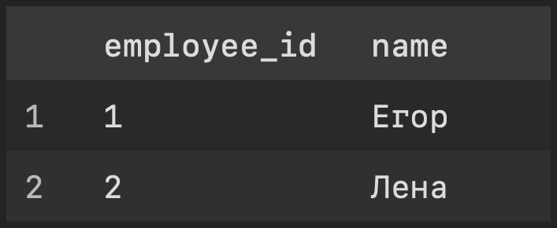
