# HW7 — Транзакции

[Схема БД](../HW2/homework2.sql). T1 и T2 — два подключения.

```sql
-- Отдельные заказы для каждого сценария.
INSERT INTO studio_order (order_id, client_id, description, status)
SELECT id, 1, 'HW7 ' || id, 'new'
FROM generate_series(101, 126) AS t(id)
WHERE NOT EXISTS (
    SELECT 1
    FROM studio_order AS existing
    WHERE existing.order_id = id
);
```

## 1. Базовые операции

### 1.1 COMMIT

```sql
BEGIN;
INSERT INTO video (video_id, order_id, description) VALUES (2010, 101, 'HW7');
UPDATE studio_order SET status = 'done' WHERE order_id = 101;
COMMIT;
SELECT status FROM studio_order WHERE order_id = 101;
SELECT count(*) AS videos FROM video WHERE video_id = 2010;
```

Статус стал `done`, видео найдено. Оба изменения сохранились.

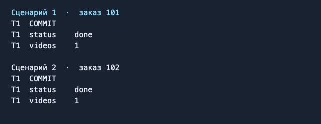

### 1.2 ROLLBACK

```sql
BEGIN;
INSERT INTO video (video_id, order_id, description) VALUES (2030, 103, 'HW7');
UPDATE studio_order SET status = 'done' WHERE order_id = 103;
ROLLBACK;
SELECT status FROM studio_order WHERE order_id = 103;
SELECT count(*) AS videos FROM video WHERE video_id = 2030;
```

Статус остался `new`, видео не найдено.

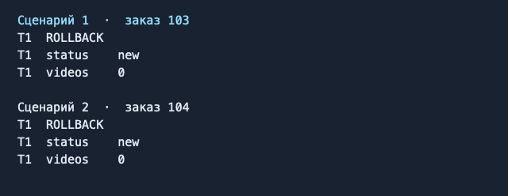

### 1.3 Ошибка внутри транзакции

```sql
BEGIN;
INSERT INTO video (video_id, order_id, description) VALUES (2050, 105, 'HW7');
UPDATE studio_order SET status = 'done' WHERE order_id = 105;
-- Намеренная ошибка
SELECT 1 / 0;
ROLLBACK;
SELECT status FROM studio_order WHERE order_id = 105;
SELECT count(*) AS videos FROM video WHERE video_id = 2050;
```

Ошибка `22012` переводит транзакцию в прерванное состояние. После отката ни видео, ни обновление не сохранились.

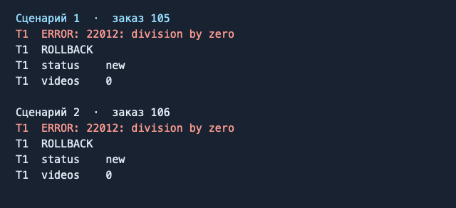

## 2. Уровни изоляции

### 2.1 Грязное чтение в READ UNCOMMITTED

```sql
-- T1
BEGIN;
UPDATE studio_order SET status = 'done' WHERE order_id = 107;

-- T2
BEGIN ISOLATION LEVEL READ UNCOMMITTED;
SELECT status FROM studio_order WHERE order_id = 107;

-- T1
ROLLBACK;

-- T2
COMMIT;
```

T2 видит `new`, хотя T1 уже выполнила обновление.

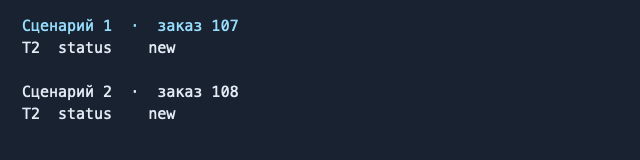

### 2.2 Грязное чтение в READ COMMITTED

```sql
-- T1
BEGIN;
UPDATE studio_order SET status = 'done' WHERE order_id = 109;

-- T2
BEGIN ISOLATION LEVEL READ COMMITTED;
SELECT status FROM studio_order WHERE order_id = 109;

-- T1
ROLLBACK;

-- T2
COMMIT;
```

T2 видит только зафиксированное значение `new`.

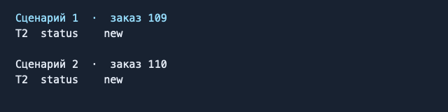

### 2.3 Неповторяющееся чтение в READ COMMITTED

```sql
-- T1
BEGIN ISOLATION LEVEL READ COMMITTED;
SELECT status FROM studio_order WHERE order_id = 111;

-- T2
BEGIN;
UPDATE studio_order SET status = 'done' WHERE order_id = 111;
COMMIT;

-- T1
SELECT status FROM studio_order WHERE order_id = 111;
COMMIT;
SELECT status FROM studio_order WHERE order_id = 111;
```

В одной транзакции T1 получаются разные результаты: сначала `new`, затем `done`.

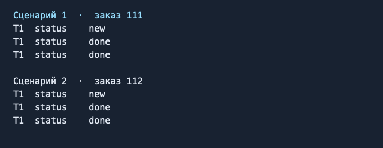

### 2.4 Фантом в READ COMMITTED

```sql
-- T1
BEGIN ISOLATION LEVEL READ COMMITTED;
SELECT count(*) AS videos FROM video WHERE order_id = 113;

-- T2
BEGIN;
INSERT INTO video (video_id, order_id, description) VALUES (2130, 113, 'HW7');
COMMIT;

-- T1
SELECT count(*) AS videos FROM video WHERE order_id = 113;
COMMIT;
SELECT count(*) AS videos FROM video WHERE order_id = 113;
```

Повторная выборка в T1 видит новую строку: во второй выборке счётчик меняется с `0` на `1`.

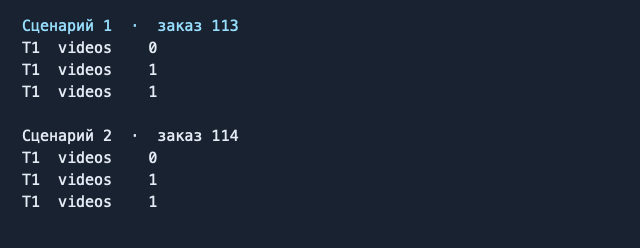

### 2.5 Повторное чтение в REPEATABLE READ

```sql
-- T1
BEGIN ISOLATION LEVEL REPEATABLE READ;
SELECT status FROM studio_order WHERE order_id = 115;

-- T2
BEGIN;
UPDATE studio_order SET status = 'done' WHERE order_id = 115;
COMMIT;

-- T1
SELECT status FROM studio_order WHERE order_id = 115;
COMMIT;
SELECT status FROM studio_order WHERE order_id = 115;
```

Оба чтения T1 дают `new`, поэтому обновление из T2 не видно внутри T1. Значение `done` появляется только в новом чтении после завершения T1.


### 2.6 Проверка фантома в REPEATABLE READ

```sql
-- T1
BEGIN ISOLATION LEVEL REPEATABLE READ;
SELECT count(*) AS videos FROM video WHERE order_id = 117;

-- T2
BEGIN;
INSERT INTO video (video_id, order_id, description) VALUES (2170, 117, 'HW7');
COMMIT;

-- T1
SELECT count(*) AS videos FROM video WHERE order_id = 117;
COMMIT;
SELECT count(*) AS videos FROM video WHERE order_id = 117;
```

Внутри T1 счётчик остаётся `0` даже после вставки и COMMIT в T2. Новое чтение после завершения T1 видит `1`. В PostgreSQL фантом в REPEATABLE READ не воспроизводится.


### 2.7 Конкурирующие вставки в SERIALIZABLE

```sql
-- T1
BEGIN ISOLATION LEVEL SERIALIZABLE;
SELECT count(*) AS videos FROM video WHERE order_id = 119;

-- T2
BEGIN ISOLATION LEVEL SERIALIZABLE;
SELECT count(*) AS videos FROM video WHERE order_id = 119;

-- T1
INSERT INTO video (video_id, order_id, description) VALUES (2190, 119, 'Черновик');

-- T2
INSERT INTO video (video_id, order_id, description) VALUES (2191, 119, 'Черновик');

-- T1
COMMIT;

-- T2
COMMIT;
BEGIN ISOLATION LEVEL SERIALIZABLE;
SELECT count(*) AS videos FROM video WHERE order_id = 119;
INSERT INTO video (video_id, order_id, description) SELECT 2191, 119, 'Черновик' WHERE NOT EXISTS (SELECT 1 FROM video WHERE order_id = 119);
COMMIT;
```

Одна транзакция завершилась ошибкой `40001`, а не нарушением уникальности ключа. После повторной проверки вторая вставка не нужна.

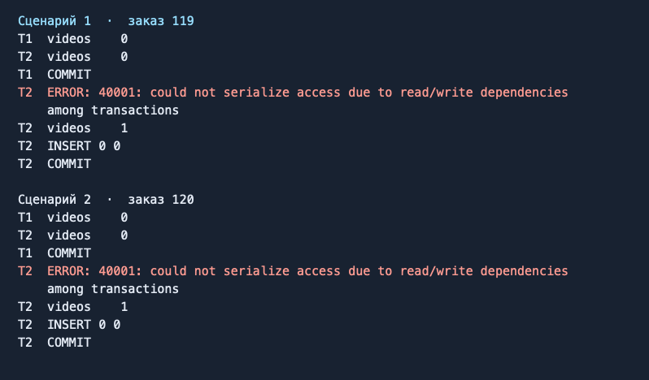

### 2.8 Конкурирующие обновления в SERIALIZABLE

```sql
-- T1
BEGIN ISOLATION LEVEL SERIALIZABLE;

-- T2
BEGIN ISOLATION LEVEL SERIALIZABLE;
SELECT status FROM studio_order WHERE order_id = 121;

-- T1
UPDATE studio_order SET status = 'editing' WHERE order_id = 121;
COMMIT;

-- T2
UPDATE studio_order SET status = 'done' WHERE order_id = 121;
ROLLBACK;
BEGIN ISOLATION LEVEL SERIALIZABLE;
SELECT status FROM studio_order WHERE order_id = 121;
UPDATE studio_order SET status = 'done' WHERE order_id = 121;
COMMIT;
SELECT status FROM studio_order WHERE order_id = 121;
```

Первый UPDATE из T2 вернул `40001: could not serialize access due to concurrent update`. После ROLLBACK повтор видит `editing` и фиксирует `done`.

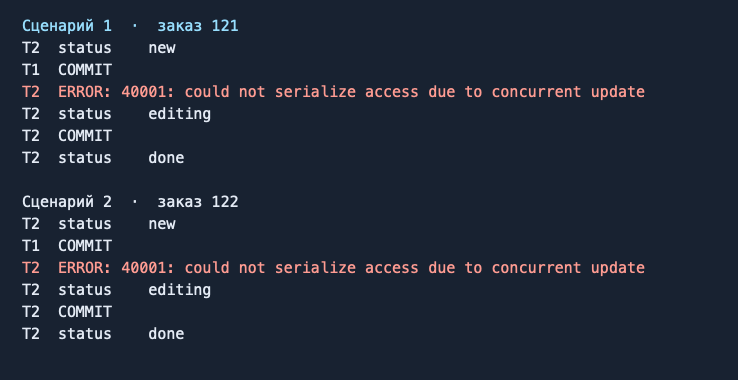

## 3. SAVEPOINT

### 3.1 Одна точка сохранения

```sql
BEGIN;
UPDATE studio_order SET status = 'editing' WHERE order_id = 123;
SAVEPOINT before_video;
INSERT INTO video (video_id, order_id, description) VALUES (2230, 123, 'HW7');
ROLLBACK TO SAVEPOINT before_video;
COMMIT;
SELECT status FROM studio_order WHERE order_id = 123;
SELECT count(*) AS videos FROM video WHERE video_id = 2230;
```

Статус `editing` остался, видео не сохранилось.

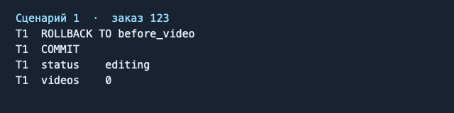

### 3.2 Две точки сохранения

```sql
BEGIN;
UPDATE studio_order SET status = 'editing' WHERE order_id = 125;
SAVEPOINT first_step;
INSERT INTO video (video_id, order_id, description) VALUES (2250, 125, 'HW7');
SAVEPOINT second_step;
UPDATE studio_order SET status = 'done' WHERE order_id = 125;
ROLLBACK TO SAVEPOINT second_step;
SELECT status FROM studio_order WHERE order_id = 125;
SELECT count(*) AS videos FROM video WHERE video_id = 2250;
ROLLBACK TO SAVEPOINT first_step;
SELECT status FROM studio_order WHERE order_id = 125;
SELECT count(*) AS videos FROM video WHERE video_id = 2250;
COMMIT;
```

После отката ко второй точке остаётся видео, но не статус `done`. После отката к первой видео исчезает, а `editing` сохраняется.

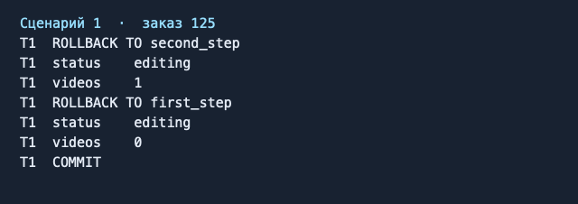

## Выводы

В PostgreSQL `READ UNCOMMITTED` работает как `READ COMMITTED`. При `READ COMMITTED` запросы внутри одной транзакции могут видеть разные снимки, при `REPEATABLE READ` снимок не меняется и фантомов нет. При `40001` повторяется вся транзакция.

`ROLLBACK` отменяет всю транзакцию. `ROLLBACK TO SAVEPOINT` отменяет только изменения после точки и удаляет более поздние точки.
